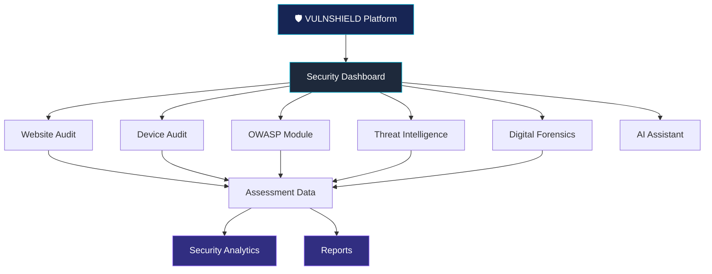

# 🛡️ VULNSHIELD
### AI-Powered Cybersecurity Assessment Platform

<p align="center">
  
</p>

<p align="center">
  <strong>Assess. Detect. Analyze. Secure.</strong>
</p>

<p align="center">
  A unified cybersecurity assessment platform designed to explore website security, device auditing, vulnerability awareness, threat intelligence, digital forensics, and security analytics.
</p>

<p align="center">
  
  
  
  
</p>

<p align="center">
  <a href="https://github.com/Sanhita2006/VULNSHIELD-AI-Powered-Cybersecurity-Assessment-Platform">
    
  </a>
  
</p>

---

## 📌 Table of Contents

- [Overview](#-overview)
- [Why VULNSHIELD?](#-why-vulnshield)
- [Key Features](#-key-features)
- [Platform Modules](#-platform-modules)
- [Technology Stack](#-technology-stack)
- [System Architecture](#-system-architecture)
- [Project Structure](#-project-structure)
- [Getting Started](#-getting-started)
- [Available Scripts](#-available-scripts)
- [Screenshots](#-screenshots)
- [Future Enhancements](#-future-enhancements)
- [Security & Ethical Use](#-security--ethical-use)
- [Contributing](#-contributing)
- [Author](#-author)

---

## 🚀 Overview

**VULNSHIELD** is an AI-assisted cybersecurity assessment platform developed to bring multiple security-related capabilities into one centralized environment.

As digital threats continue to evolve, understanding vulnerabilities and maintaining security awareness have become increasingly important for developers, organizations, and technology enthusiasts.

VULNSHIELD aims to make cybersecurity assessment more accessible through a modular platform that combines website auditing, device security assessment, OWASP vulnerability awareness, threat intelligence, digital forensics, analytics, and reporting.

The platform features a modern **Security Operations Center (SOC)-inspired interface**, providing a centralized environment to explore security information and assessment activities.

### 🎯 Our Mission

To make cybersecurity assessment more accessible, understandable, and organized through an intelligent and user-friendly platform.

---

## 💡 Why VULNSHIELD?

Traditional security workflows often involve switching between different tools and interfaces to understand different security aspects.

VULNSHIELD aims to address this fragmentation through:

- **Unified Experience:** Multiple cybersecurity modules in one platform.
- **Security Awareness:** Better understanding of vulnerabilities and potential risks.
- **Visual Insights:** Dashboard-driven security information and analytics.
- **Modular Design:** Dedicated modules for different cybersecurity domains.
- **Modern Interface:** A professional SOC-inspired user experience.
- **Continuous Improvement:** An extensible foundation for future security integrations.

---

## ✨ Key Features

| Feature | Description |
|---|---|
| 🛡️ Security Dashboard | Centralized security overview and assessment information |
| 🌐 Website Audit | Website security assessment interface |
| 💻 Device Audit | Device-related security assessment |
| 🔐 OWASP Module | Web application vulnerability awareness |
| 🛰️ Threat Intelligence | Threat-related information and insights |
| 🔬 Digital Forensics | Forensic analysis utilities and investigation information |
| 📊 Security Analytics | Visual representation of security assessment data |
| 📄 Reports | Assessment summaries and scan history |
| 🤖 AI Assistant | Interface for AI-assisted cybersecurity guidance |

---

## 🧩 Platform Modules

### 01. 📊 Security Dashboard

The central control panel of VULNSHIELD.

- Security posture overview.
- Assessment-related metrics.
- Security indicators.
- Visual data representation.
- Quick access to platform modules.

### 02. 🌐 Website Security Audit

A dedicated interface for examining website security.

- Website assessment workflow.
- Security-related findings.
- Potential vulnerability insights.
- Assessment summaries.

### 03. 🔐 OWASP Security Module

Explore common web application security risks using the OWASP Top 10 framework.

- OWASP vulnerability categories.
- Security explanations.
- Risk awareness.
- Security recommendations.

### 04. 💻 Device Security Audit

A dedicated module for exploring device security assessment.

- Device assessment interface.
- Security status information.
- Potential risk indicators.
- Assessment overview.

### 05. 🛰️ Threat Intelligence

A centralized interface for exploring cybersecurity threat information.

- Threat intelligence overview.
- Threat-related insights.
- Security information visualization.
- Threat monitoring interface.

### 06. 🔬 Digital Forensics

A dedicated module for digital investigation workflows.

- File-related forensic utilities.
- Hash-based analysis support.
- Investigation information.
- Forensic result presentation.

### 07. 📈 Security Analytics

Understand security assessment information through visual analytics.

- Interactive charts.
- Security posture visualization.
- Assessment metrics.
- Data-driven insights.

### 08. 📄 Security Reports

A dedicated reporting module for organizing assessment information.

- Scan history.
- Assessment summaries.
- Report presentation.
- Report export functionality where supported.

### 09. 🤖 AI Security Assistant

An assistant interface designed to make cybersecurity information easier to understand.

- Cybersecurity-related assistance.
- Security concept explanations.
- AI-assisted interaction.
- Guidance for security-related questions.

---

## 🛠️ Technology Stack

VULNSHIELD is developed using a modern web development ecosystem.

<p align="center">
  
</p>

| Technology | Purpose |
|---|---|
| React | Frontend UI development |
| TypeScript | Type-safe application development |
| Vite | Development server and build tooling |
| TanStack Router | Application routing |
| Recharts | Data visualization |
| Lucide React | Icons and interface elements |
| CSS / Tailwind CSS | Interface styling |
| Vitest | Testing framework |
| Git & GitHub | Version control and collaboration |

---

## 🏗️ System Architecture

VULNSHIELD follows a modular frontend architecture where different cybersecurity capabilities are organized into dedicated application modules.



---

## 📂 Project Structure

```text
VULNSHIELD/
│
├── public/
│
├── assets/
│   ├── vulnshield-banner.png
│   ├── dashboard.png
│   ├── website-audit.png
│   ├── device-audit.png
│   ├── threat-intel.png
│   ├── forensics.png
│   └── analytics.png
│
├── src/
│   │
│   ├── components/
│   │
│   ├── hooks/
│   │
│   ├── lib/
│   │   ├── analytics-data/
│   │   ├── audit.functions
│   │   ├── demo-data/
│   │   ├── device-audit/
│   │   ├── md5.ts
│   │   ├── nav.ts
│   │   ├── owasp-data/
│   │   └── scan-store/
│   │
│   ├── routes/
│   │   ├── index.tsx
│   │   ├── website-audit.tsx
│   │   ├── device-audit.tsx
│   │   ├── owasp.tsx
│   │   ├── threat-intel.tsx
│   │   ├── forensics.tsx
│   │   ├── analytics.tsx
│   │   ├── reports.tsx
│   │   └── assistant.tsx
│   │
│   └── ...
│
├── package.json
├── vite.config.ts
├── tsconfig.json
├── index.html
└── README.md
```

---

## ⚡ Getting Started

Follow the instructions below to set up VULNSHIELD on your local machine.

### Prerequisites

Make sure you have installed:

- [Node.js](https://nodejs.org/)
- npm
- [Git](https://git-scm.com/)
- [Visual Studio Code](https://code.visualstudio.com/) (Recommended)

### 1. Clone the Repository

```bash
git clone https://github.com/Sanhita2006/VULNSHIELD-AI-Powered-Cybersecurity-Assessment-Platform.git
```

### 2. Navigate to the Project Directory

```bash
cd VULNSHIELD-AI-Powered-Cybersecurity-Assessment-Platform
```

### 3. Install Dependencies

```bash
npm install
```

### 4. Start the Development Server

```bash
npm run dev
```

### 5. Open in Your Browser

Visit the local development URL displayed in your terminal.

Usually:

```text
http://localhost:5173
```

Congratulations! 🎉 VULNSHIELD should now be running locally.

---

## 🧪 Available Scripts

| Command | Description |
|---|---|
| `npm run dev` | Starts the development server |
| `npm run build` | Creates a production build |
| `npm run test` | Runs the test suite |

---


## 🔮 Future Enhancements

VULNSHIELD is designed to evolve with additional cybersecurity capabilities.

Potential future improvements include:

- [ ] Expand automated vulnerability detection.
- [ ] Integrate additional security assessment tools.
- [ ] Improve AI-assisted security analysis.
- [ ] Integrate real-time threat intelligence sources.
- [ ] Introduce advanced security monitoring.
- [ ] Enhance forensic investigation capabilities.
- [ ] Expand report customization and export options.
- [ ] Add more automated testing and validation.
- [ ] Improve security assessment accuracy and coverage.

---

## 🔒 Security & Ethical Use

VULNSHIELD is intended for educational, research, and authorized cybersecurity assessment purposes.

Users are expected to:

- Only test websites, devices, and systems they own or have explicit permission to assess.
- Follow responsible security research practices.
- Respect privacy and data protection requirements.
- Avoid unauthorized access, exploitation, or disruption.
- Validate security findings before making security decisions.

**Disclaimer:** VULNSHIELD is a cybersecurity learning and assessment project. Its results do not guarantee complete security or the absence of vulnerabilities. It should not replace professional security audits or penetration testing.

---

## 🤝 Contributing

Contributions, suggestions, and feedback are welcome!

If you would like to contribute:

1. Fork this repository.
2. Create a new feature branch.
3. Make your changes.
4. Commit your changes.
5. Open a Pull Request.

```bash
git checkout -b feature/your-feature-name

git add .

git commit -m "Add: your feature description"

git push origin feature/your-feature-name
```

---

## 👩‍💻 Author

<p align="center">
  
</p>

<h3 align="center">Sanhita Bhattacharjee</h3>

<p align="center">
  B.Tech Computer Science & Engineering<br/>
  Cybersecurity Enthusiast | Developer | Technology Explorer
</p>

<p align="center">
  <a href="https://github.com/Sanhita2006">
    
  </a>
</p>

---

## ⭐ Show Your Support

If you find VULNSHIELD interesting or useful:

- ⭐ Star this repository.
- 🍴 Fork the project.
- 💬 Share your feedback.
- 🤝 Contribute to its development.

Your support motivates further development and improvement!

---

<p align="center">
  
</p>

<h2 align="center">🛡️ VULNSHIELD</h2>

<p align="center">
  <strong>Building a More Secure Digital Future.</strong>
</p>

<p align="center">
  <i>Assess. Detect. Analyze. Secure.</i>
</p>
